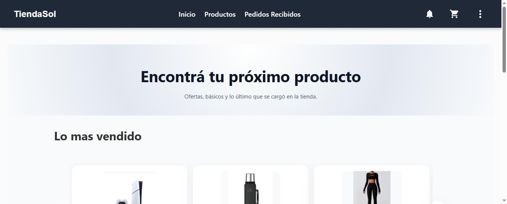

# Tienda Sol: e-commerce full stack

Tienda online con compradores y vendedores: carrito, pedidos con estados, notificaciones y login por roles. Proyecto académico (UTN-FRBA, 2025), en un equipo de 5.

### [🛒 Probar la tienda en vivo](https://tienda-sol-ecommerce.vercel.app)




## Probala

- **Comprador:** tocá **Iniciar sesión → Creá tu cuenta** y hacé un pedido.
- **Vendedor:** entrá con **`vendedor`** / **`Demo-f2PEDewa`** y abrí **Pedidos Recibidos**.

> Si el login tarda en aparecer, esperá un minuto: el servidor gratuito se está despertando.

## Qué hicimos

Construimos en equipo un marketplace estilo Mercado Libre, de punta a punta. Del lado del backend armamos una **API REST en capas** con Node.js, Express y MongoDB, donde el pedido funciona como una **máquina de estados** con reglas de negocio: solo el comprador cancela, solo el vendedor envía, el stock se descuenta y se devuelve, y cada cambio genera una notificación. La seguridad la resolvimos con **Keycloak y JWT**, con permisos por rol en el menú, las rutas y la API. El frontend en **React** tiene catálogo con filtros, carrito, checkout y seguimiento de pedidos, y se adapta al celular. Tiene **tests en Jest**, se levanta con **Docker** y está **desplegado en la nube**.

<details>
<summary><b>Correrlo en tu máquina</b></summary>

Necesitás **Docker** y **Node.js 20+**.

```bash
cp packages/backend/.env.example packages/backend/.env
docker compose up -d --build
npm install
npm run start:frontend
```

Abrí `http://localhost:3000`. En local, el vendedor es **`vendedor`** / **`Vendedor123!`**. Tests: `npm test`.
</details>
