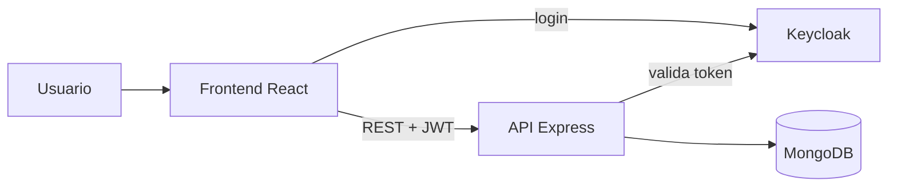

# Tienda Sol: e-commerce full stack

**Plataforma de compra y venta online con roles de comprador y vendedor, carrito, pedidos con estados y notificaciones.** Proyecto académico de Desarrollo de Software (UTN-FRBA, 2025), en un equipo de 5.


## De qué se trata

Construimos una tienda online completa, de punta a punta:
- **Compradores:** se registran, buscan productos con filtros y paginación, arman un carrito, hacen pedidos y los siguen.
- **Vendedores:** reciben esos pedidos y los gestionan.
- **El pedido** pasa por estados (confirmado, rechazado, enviado, cancelado y finalizado) con reglas de negocio: solo el comprador puede cancelar, solo el vendedor puede enviar, y no se puede cancelar algo ya enviado.
- **Notificaciones:** cada cambio de estado se le avisa al usuario que corresponde.

| | |
|---|---|
| 🧱 **Backend** | API REST en Node.js + Express, arquitectura en capas (rutas → controladores → servicios → repositorios), MongoDB con Mongoose |
| 🖥️ **Frontend** | React 19 con React Router y Material UI |
| 🔐 **Seguridad** | Login y roles (comprador y vendedor) con **Keycloak + JWT**, con tema de login propio |
| ✅ **Calidad** | Validación de datos con **Zod**, **14 excepciones de dominio** y tests unitarios y de integración con **Jest + Supertest** |
| 🛠️ **Infra** | **Docker Compose** (MongoDB, Keycloak y PostgreSQL), documentación de la API con **Swagger**, logs con Winston |



## Mi rol

- **Gestión de pedidos, de punta a punta:** modelo de dominio, servicio, controlador, validaciones con Zod, persistencia y sus tests.
- **Integración con Keycloak:** login y control de acceso por rol.
- **Pantallas del frontend:** carrito, "Pedidos hechos" y "Pedidos recibidos".
- **Logging del backend** con Winston.

<details>
<summary><b>Cómo correrlo</b></summary>

1. **Levantar MongoDB y Keycloak** con Docker:
   ```bash
   docker compose up -d
   ```
2. **Instalar las dependencias** desde la raíz del monorepo:
   ```bash
   npm install
   ```
3. **Configurar las variables de entorno** en `packages/backend/.env` (orígenes permitidos, puerto, MongoDB y Keycloak).
4. **Iniciar el backend y el frontend juntos:**
   ```bash
   npm run start:dev
   ```
   El backend corre en `http://localhost:3001` y el frontend en `http://localhost:3000`.
5. **Correr los tests:**
   ```bash
   npm test
   ```
</details>
