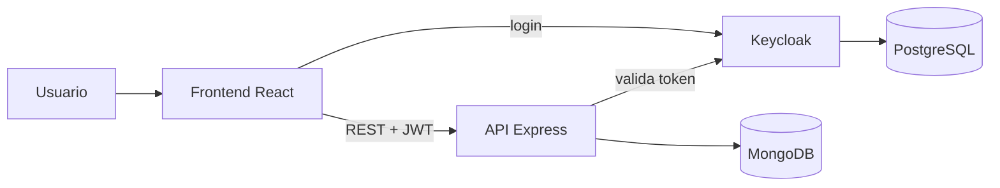

# Tienda Sol: e-commerce full stack

**Plataforma de compra y venta online con roles de comprador y vendedor, carrito, pedidos con estados y notificaciones.** Proyecto académico de Desarrollo de Software (UTN-FRBA, 2025), en un equipo de 5.

### [🛒 Probar la tienda en vivo](https://tienda-sol-ecommerce.vercel.app)


## Probala en 1 minuto

| Querés ver… | Cómo |
|---|---|
| **La tienda como visitante** | Entrá al [link](https://tienda-sol-ecommerce.vercel.app): podés buscar, filtrar y armar el carrito sin cuenta. |
| **La experiencia del comprador** | Tocá **Iniciar sesión → Creá tu cuenta**. Al registrarte entrás directo, ya con tu sesión, y podés hacer un pedido. |
| **La experiencia del vendedor** | Iniciá sesión con el usuario de demo **`vendedor`** / contraseña **`Demo-f2PEDewa`** y entrá a **Pedidos Recibidos**. |

> El servicio de login corre en un plan gratis que se duerme cuando nadie lo usa. Si tarda en aparecer la pantalla de login, esperá alrededor de un minuto: se está despertando.

## De qué se trata

Construimos una tienda online completa, de punta a punta:
- **Compradores:** se registran, buscan productos con filtros y paginación, arman un carrito, hacen pedidos y los siguen.
- **Vendedores:** reciben esos pedidos y los gestionan.
- **El pedido** pasa por estados (confirmado, rechazado, enviado, cancelado y finalizado) con reglas de negocio: solo el comprador puede cancelar, solo el vendedor puede enviar, y no se puede cancelar algo ya enviado.
- **Notificaciones:** cada cambio de estado se le avisa al usuario que corresponde.
- **Permisos por rol en todas las capas:** cada usuario ve solo su menú, las rutas del frontend lo validan y la API rechaza los pedidos de quien no tiene el rol.


| | |
|---|---|
| 🧱 **Backend** | API REST en Node.js + Express, arquitectura en capas (rutas → controladores → servicios → repositorios), MongoDB con Mongoose |
| 🖥️ **Frontend** | React 19 con React Router y Material UI |
| 🔐 **Seguridad** | Login y roles (comprador y vendedor) con **Keycloak + JWT**, con tema de login propio |
| ✅ **Calidad** | Validación de datos con **Zod**, **14 excepciones de dominio** y tests unitarios y de integración con **Jest + Supertest** |
| 🛠️ **Infra** | **Docker Compose** (MongoDB, Keycloak y PostgreSQL), documentación de la API con **Swagger**, logs con Winston |



<details>
<summary><b>Cómo correrlo en tu máquina</b></summary>

Necesitás **Docker** y **Node.js 20+**.

1. **Levantar MongoDB, Keycloak, PostgreSQL y la API.** Docker además crea el realm, los roles y el usuario vendedor, y carga los productos:
   ```bash
   cp packages/backend/.env.example packages/backend/.env
   docker compose up -d --build
   ```
2. **Instalar las dependencias** desde la raíz del monorepo:
   ```bash
   npm install
   ```
3. **Iniciar el frontend:**
   ```bash
   npm run start:frontend
   ```
4. **Abrir la tienda** en `http://localhost:3000`:
   - **Como visitante:** podés buscar, filtrar y armar el carrito sin cuenta.
   - **Como comprador:** tocá **Iniciar sesión → Creá tu cuenta**; al registrarte entrás directo y podés hacer un pedido.
   - **Como vendedor:** iniciá sesión con **`vendedor`** / **`Vendedor123!`** y entrá a **Pedidos Recibidos**.

   La API queda en `http://localhost:3001` y Keycloak en `http://localhost:8080`.
5. **Correr los tests:**
   ```bash
   npm test
   ```

</details>
