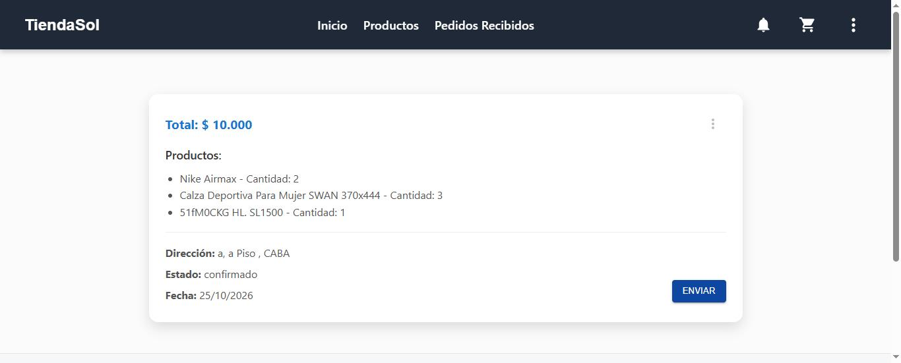
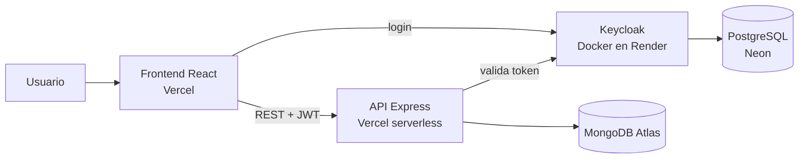

# Tienda Sol: e-commerce full stack

**Plataforma de compra y venta online con roles de comprador y vendedor, carrito, pedidos con estados y notificaciones.** Proyecto académico de Desarrollo de Software (UTN-FRBA, 2025), en un equipo de 5. Está **desplegada en la nube y se puede probar ahora mismo.**

### [🛒 Probar la tienda en vivo](https://tienda-sol-ecommerce.vercel.app)


## Probala en 1 minuto

| Querés ver… | Cómo |
|---|---|
| **La tienda como visitante** | Entrá al [link](https://tienda-sol-ecommerce.vercel.app): podés buscar, filtrar y armar el carrito sin cuenta. |
| **La experiencia del comprador** | Tocá **Iniciar sesión → Creá tu cuenta**. Al registrarte entrás directo, ya con tu sesión, y podés hacer un pedido. |
| **La experiencia del vendedor** | Iniciá sesión con el usuario de demo **`vendedor`** / contraseña **`Demo-f2PEDewa`** y entrá a **Pedidos Recibidos**. |

> El login corre en el plan gratis de Render. Si nadie lo usó en un rato, la primera vez puede tardar unos segundos más.

## De qué se trata

Construimos una tienda online completa, de punta a punta:
- **Compradores:** se registran, buscan productos con filtros y paginación, arman un carrito, hacen pedidos y los siguen.
- **Vendedores:** reciben esos pedidos y los gestionan.
- **El pedido** pasa por estados (confirmado, rechazado, enviado, cancelado y finalizado) con reglas de negocio: solo el comprador puede cancelar, solo el vendedor puede enviar, y no se puede cancelar algo ya enviado.
- **Notificaciones:** cada cambio de estado se le avisa al usuario que corresponde.
- **Permisos por rol en todas las capas:** cada usuario ve solo su menú, las rutas del frontend lo validan y la API rechaza los pedidos de quien no tiene el rol.



| | |
|---|---|
| 🧱 **Backend** | API REST en Node.js + Express, arquitectura en capas (rutas → controladores → servicios → repositorios), MongoDB con Mongoose |
| 🖥️ **Frontend** | React 19 con React Router y Material UI |
| 🔐 **Seguridad** | Login y roles (comprador y vendedor) con **Keycloak + JWT**, con tema de login propio |
| ✅ **Calidad** | Validación de datos con **Zod**, **14 excepciones de dominio** y tests unitarios y de integración con **Jest + Supertest** |
| ☁️ **Nube** | Frontend y API en **Vercel** (la API como función serverless), **MongoDB Atlas**, Keycloak en **Docker sobre Render** con base **PostgreSQL en Neon** |
| 🛠️ **Infra local** | **Docker Compose** (MongoDB, Keycloak y PostgreSQL), documentación de la API con **Swagger**, logs con Winston |

## Arquitectura en la nube



Algunas decisiones que tomamos al llevarla a la nube:
- **La tienda no espera al login:** Keycloak se conecta por detrás, así que la página abre en ~1 segundo aunque el servicio de login esté arrancando.
- **Keycloak entra en 512 MB:** caché local en vez de clúster y una JVM ajustada (SerialGC y heap fijo) para el plan gratis.
- **Keycloak y su base en la misma región** (Oregón), para que cada paso del login no cruce el continente.
- **Conexión a MongoDB reutilizada** entre invocaciones de la función serverless.
- **Un workflow de GitHub Actions** visita Keycloak cada 10 minutos para que Render no lo duerma.

## Mi rol

- **Gestión de pedidos, de punta a punta:** modelo de dominio, servicio, controlador, validaciones con Zod, persistencia y sus tests.
- **Integración con Keycloak:** login y control de acceso por rol.
- **Pantallas del frontend:** carrito, "Pedidos hechos" y "Pedidos recibidos".
- **Logging del backend** con Winston.
- **Despliegue en la nube** (Vercel, Render, Neon y MongoDB Atlas).

<details>
<summary><b>Cómo correrlo en tu máquina</b></summary>

Necesitás **Docker** y **Node.js 20+**.

1. **Levantar MongoDB, Keycloak, PostgreSQL y la API.** Docker crea el realm, los roles, el usuario vendedor y carga los productos:
   ```bash
   cp packages/backend/.env.example packages/backend/.env
   docker compose up -d --build
   ```
2. **Instalar las dependencias** desde la raíz del monorepo:
   ```bash
   npm install
   ```
3. **Iniciar el frontend:**
   ```bash
   npm run start:frontend
   ```
   La tienda queda en `http://localhost:3000`, la API en `http://localhost:3001` y Keycloak en `http://localhost:8080`.
4. **Correr los tests:**
   ```bash
   npm test
   ```
</details>

<details>
<summary><b>Cómo desplegarlo en la nube (todo en planes gratis)</b></summary>

1. **Base de Keycloak:** creá un proyecto en [Neon](https://neon.tech) (PostgreSQL), en la misma región donde vas a correr Keycloak.
2. **Keycloak en Render:** creá un *Blueprint* desde este repo; usa [`render.yaml`](render.yaml) y el [`keycloak/Dockerfile`](keycloak/Dockerfile), que ya incluye el tema de login. Cargá las variables secretas:
   - `KC_DB_URL` → `jdbc:postgresql://<host de Neon>/<base>?sslmode=require`
   - `KC_DB_USERNAME`, `KC_DB_PASSWORD`
   - `KC_BOOTSTRAP_ADMIN_USERNAME`, `KC_BOOTSTRAP_ADMIN_PASSWORD`
3. **MongoDB:** creá una base en MongoDB Atlas (o conectala desde *Storage* en Vercel).
4. **Configurar el realm y cargar productos:** corré [`scripts/bootstrap/init-stack.mjs`](scripts/bootstrap/init-stack.mjs) contra tu Keycloak. Crea el realm `ecommerce`, los roles, los clientes, el usuario vendedor y los productos:
   ```bash
   KEYCLOAK_BASE_URL=https://<tu-keycloak>.onrender.com \
   KEYCLOAK_ADMIN=<admin> KEYCLOAK_ADMIN_PASSWORD=<contraseña> \
   KEYCLOAK_BACKEND_CLIENT_SECRET=<un secreto nuevo> \
   FRONTEND_URLS=https://<tu-tienda>.vercel.app \
   BACKEND_URLS=https://<tu-api>.vercel.app \
   MONGODB_URI=<uri de Mongo> MONGODB_DB_NAME=tienda_sol \
   VENDEDOR_PASSWORD=<contraseña del vendedor> \
   node scripts/bootstrap/init-stack.mjs
   ```
5. **API en Vercel:** proyecto nuevo con *Root Directory* `packages/backend`. Variables:
   - `KEYCLOAK_BASE_URL`, `REALM=ecommerce`, `CLIENT_ID=backend-clente`
   - `CLIENT_SECRET` (el mismo del paso 4)
   - `MONGODB_URI`, `MONGODB_DB_NAME=tienda_sol`
   - `ALLOWED_ORIGINS=https://<tu-tienda>.vercel.app`
6. **Frontend en Vercel:** proyecto nuevo con *Root Directory* `packages/frontend`. Variables:
   - `REACT_APP_API_URL`, `REACT_APP_KEYCLOAK_URL`
   - `REACT_APP_KEYCLOAK_REALM=ecommerce`, `REACT_APP_KEYCLOAK_CLIENT_ID=tp_desarrollo`
7. **(Opcional)** Actualizá la URL de Keycloak en [`.github/workflows/keep-alive.yml`](.github/workflows/keep-alive.yml) para que no se duerma.
</details>
